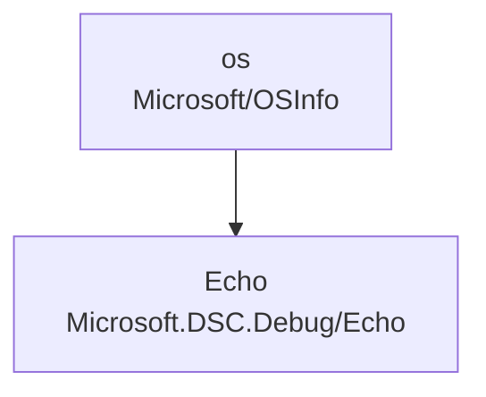
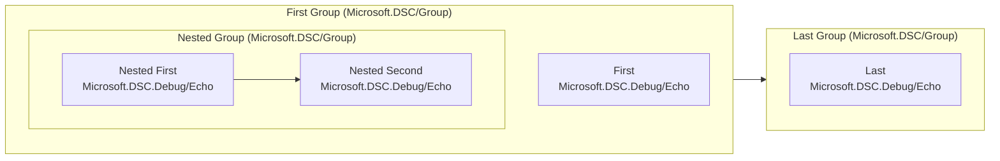

# Example: the dsc graph plug-in

This example walks through a complete command plug-in. `dsc graph` reads a configuration document
and shows which resources depend on which, as a [Mermaid][01] flowchart you can paste into a
Markdown file, or as JSON.

The plug-in is a PowerShell script and a manifest. The source is in the [plugins/graph][02] folder
of the DSC repository.

## What the command does

Given this document:

```yaml
# app.dsc.yaml
$schema: https://aka.ms/dsc/schemas/v3/bundled/config/document.json
resources:
- name: os
  type: Microsoft/OSInfo
  properties: {}
- name: Echo
  type: Microsoft.DSC.Debug/Echo
  properties:
    output: "[concat('The OS is ', reference(resourceId('Microsoft/OSInfo','os')).family)]"
  dependsOn:
  - "[resourceId('Microsoft/OSInfo','os')]"
```

```sh
dsc graph --file ./app.dsc.yaml
```

The command writes:

```text
flowchart TD
    n0["os<br/>Microsoft/OSInfo"]
    n1["Echo<br/>Microsoft.DSC.Debug/Echo"]
    n0 --> n1
```

Which renders as:



An arrow points from a resource to the resource that depends on it, which is the order DSC runs
them in. Group resources become boxes around their nested resources:



## The files

```text
plugins/graph/
    graph.dsc.plugin.json    The manifest
    graph.ps1                The command
```

Both files are installed in the same directory, anywhere DSC searches for manifests.

## Step 1: The manifest

```json
{
    "$schema": "https://aka.ms/dsc/schemas/v3/bundled/plugin/manifest.json",
    "type": "Microsoft.DSC.Samples/Graph",
    "version": "0.1.0",
    "description": "Show the dependency graph of a configuration document",
    "tags": ["sample", "graph", "authoring"],
    "condition": "[not(equals(tryWhich('pwsh'), null()))]",
    "command": {
        "name": "graph",
        "executable": "pwsh",
        "args": [
            "-NoLogo",
            "-NoProfile",
            "-NonInteractive",
            "-File",
            { "manifestRelativePath": "graph.ps1" }
        ]
    }
}
```

- The command is `graph`, so users run `dsc graph`.
- The executable is `pwsh`, and the script is passed to it with `manifestRelativePath`, so the
  manifest works wherever the two files are installed.
- The `condition` hides the command on a machine without PowerShell.

For guidance on each property, see [Defining a DSC plug-in manifest][05].

## Step 2: Parse the arguments

DSC runs the script with the arguments the user typed after `graph`. The script parses them
itself, writes an error for a mistake, and exits with code `1`:

```powershell
default {
    Write-Trace -Level error -Message "Unknown argument '$argument'. Use --help to see the options."
    exit $exitInvalidArgs
}
```

It handles `--help` first and shows the usage with the command the user typed. For guidance, see
[Designing a DSC plug-in command][06].

## Step 3: Read the document

The document comes from `--file`, from `--input`, or from standard input:

```powershell
if ($null -ne $options.Input) {
    $text = $options.Input
} elseif ($null -ne $options.File -and $options.File -ne '-') {
    # The script first checks that the file exists, and exits with code 2 when it doesn't.
    $text = Get-Content -LiteralPath $options.File -Raw
} elseif ([Console]::IsInputRedirected) {
    $text = @($input) -join "`n"
} else {
    Write-Trace -Level error -Message "No document. Use --file, --input, or pipe a document to the command."
    exit $exitInvalidArgs
}
```

The script then turns the text into an object. It tries three readers in order:

1. JSON, with `ConvertFrom-Json`.
1. YAML, with `ConvertFrom-Yaml` from the `powershell-yaml` module, or from the `Yayaml` module
   when `powershell-yaml` isn't installed.
1. YAML, by asking the DSC that started the plug-in, through `DSC_EXE`, when neither module is
   installed.

The script calls the YAML command by its module name, like `powershell-yaml\ConvertFrom-Yaml`.
Several modules export a command with that name and they don't return the same types, so the
script only uses the ones it knows.

The third reader is the example of calling back into DSC. For the code and its trade-offs, see
[Using the context DSC provides to a plug-in][07].

## Step 4: Build the graph

The script makes one node for every resource and looks for dependencies in two places:

- The `dependsOn` property, which lists `resourceId()` expressions.
- Calls to `reference(resourceId(...))` in the properties.

One regular expression finds a `resourceId()` call with a literal type and name:

```powershell
$resourceIdPattern = "resourceId\(\s*'(?<type>(?:[^']|'')*)'\s*,\s*'(?<name>(?:[^']|'')*)'\s*\)"
```

Resources nested in a group are handled by calling the same function again, with the group as the
parent. Dependencies are only looked up among the resources of the same document or group, which
is how DSC resolves them.

The script doesn't evaluate expressions. A dependency whose name is computed, for example with
`copyIndex()`, is skipped with a warning. A dependency on a resource that isn't in the document is
drawn with a dashed border, also with a warning. Both cases still return exit code `0`.

## Step 5: Write the output

The Mermaid lines go to standard output, and nothing else does:

```powershell
"flowchart $Direction"
Write-MermaidNode -Graph $Graph -Group '' -Depth 1
foreach ($edge in $Graph.edges) {
    $arrow = if ($edge.kind -eq 'dependsOn') { '-->' } else { '-.->' }
    '    {0} {1} {2}' -f $edge.from, $arrow, $edge.to
}
```

A solid arrow is a `dependsOn` entry. A dotted arrow is a `reference()` without a matching
`dependsOn` entry, which is worth noticing: DSC only uses `dependsOn` to order the resources.

With `--format json`, the same graph is written as data for other tools:

```json
{
  "nodes": [
    { "id": "n0", "name": "os", "type": "Microsoft/OSInfo" },
    { "id": "n1", "name": "Echo", "type": "Microsoft.DSC.Debug/Echo" }
  ],
  "edges": [
    { "from": "n0", "to": "n1", "kind": "dependsOn" }
  ]
}
```

## Try it

Copy `graph.dsc.plugin.json` and `graph.ps1` to a directory in `PATH`, then:

```sh
# Is the plug-in found?
dsc plugin list Microsoft.DSC.Samples/Graph

# Graph a document, left to right
dsc graph --file ./app.dsc.yaml --direction LR

# Graph a document from a pipeline
cat ./app.dsc.yaml | dsc graph

# See what the plug-in is doing
dsc --trace-level debug graph --file ./app.dsc.yaml

# Run it by its type name
dsc Microsoft.DSC.Samples/Graph --help
```

To see the picture, paste the output into a `mermaid` code block in a Markdown file, or into the
[Mermaid live editor][03].

## Limits of the sample

- The result of `dsc config get`, `set`, or `test` names the resources but not their
  dependencies. When the input is a result, the command shows the resources without arrows and
  says so at the `info` trace level.
- Expressions aren't evaluated, so computed dependencies and copy loops aren't drawn.
- Reading YAML through DSC needs the resource types in the document to be installed.

## Related content

- [Designing a DSC command plug-in][08]
- [DSC plug-in manifest schema reference][04]

<!-- Link reference definitions -->
[01]: https://mermaid.js.org/
[02]: https://github.com/PowerShell/DSC/tree/main/plugins/graph
[03]: https://mermaid.live/
[04]: ../../../reference/schemas/plugin/manifest/root.md
[05]: ./plugin-manifest.md
[06]: ./command-design.md
[07]: ./dsc-context.md#calling-back-into-dsc
[08]: ./index.md
