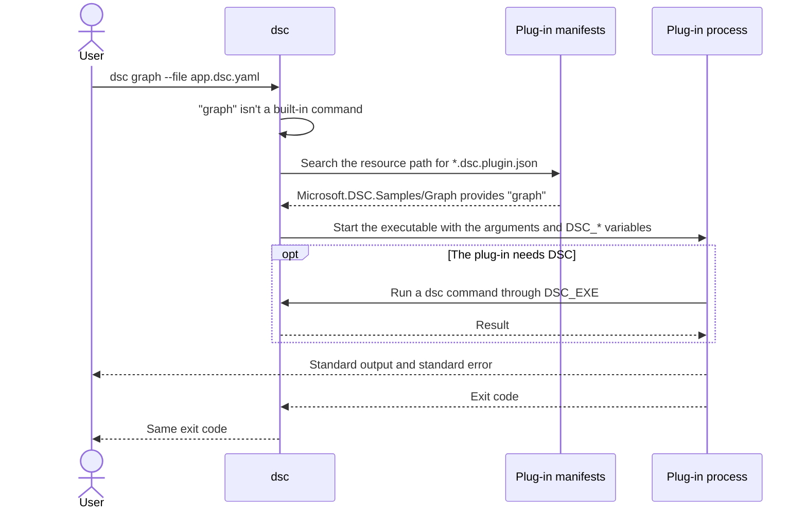

# DSC command plug-ins

A command plug-in adds a command to `dsc`. The plug-in is a separate executable or script. A
plug-in manifest next to it tells DSC the name of the command and how to start it. When a user
runs `dsc graph` and `graph` isn't a built-in command, DSC finds the plug-in that provides `graph`
and runs it.

Plug-ins let you ship a command on its own schedule, in any language, without changing DSC.

## How plug-ins differ from resources and extensions

DSC has three kinds of manifest. Each one extends DSC in a different place:

| Kind      | Extends                 | Who calls it                             |
|:----------|:------------------------|:-----------------------------------------|
| Resource  | What DSC can manage     | DSC, during a configuration operation    |
| Extension | How DSC finds and reads | DSC, during discovery, import or secrets |
| Plug-in   | The commands of `dsc`   | The user, as `dsc <command>`             |

A resource and an extension exchange JSON with DSC through a contract that DSC defines. A plug-in
has no such contract. DSC starts it, passes the arguments and the standard streams through, and
returns its exit code. The plug-in decides what its input and output look like.

## How DSC runs a plug-in command

1. DSC checks the built-in commands first. A plug-in can't replace a built-in command.
1. DSC searches the same directories it searches for resource and extension manifests for files
   that end with `.dsc.plugin.json`, `.dsc.plugin.yaml`, or `.dsc.plugin.yml`.
1. DSC starts the executable the manifest names. It passes every argument after the command name
   as written, and sets environment variables that describe the invocation.
1. The plug-in reads standard input and writes to standard output and standard error directly.
   DSC doesn't read or change them.
1. DSC exits with the exit code of the plug-in.

For the full behavior, see [Plug-in commands][01] in the `dsc` command reference.

## Finding and choosing plug-ins

- `dsc --help` lists plug-in commands after the built-in commands.
- `dsc plugin list` shows every plug-in with its type name, version and command.
- When two plug-ins provide the same command, the first one DSC finds wins and DSC writes a
  warning. To run a specific one, use its type name, like `dsc Microsoft.DSC.Samples/Graph`.
- To turn plug-ins off, set `plugins.enabled` to `false` in a DSC settings file.

## Related content

- [Designing a DSC command plug-in][04]
- [Example: the `dsc graph` plug-in][05]
- [dsc plugin][02]
- [DSC plug-in manifest schema reference][03]

<!-- Link reference definitions -->
[01]: ../../reference/cli/index.md#plug-in-commands
[02]: ../../reference/cli/plugin/index.md
[03]: ../../reference/schemas/plugin/manifest/root.md
[04]: ./authoring/index.md
[05]: ./authoring/example-graph.md
